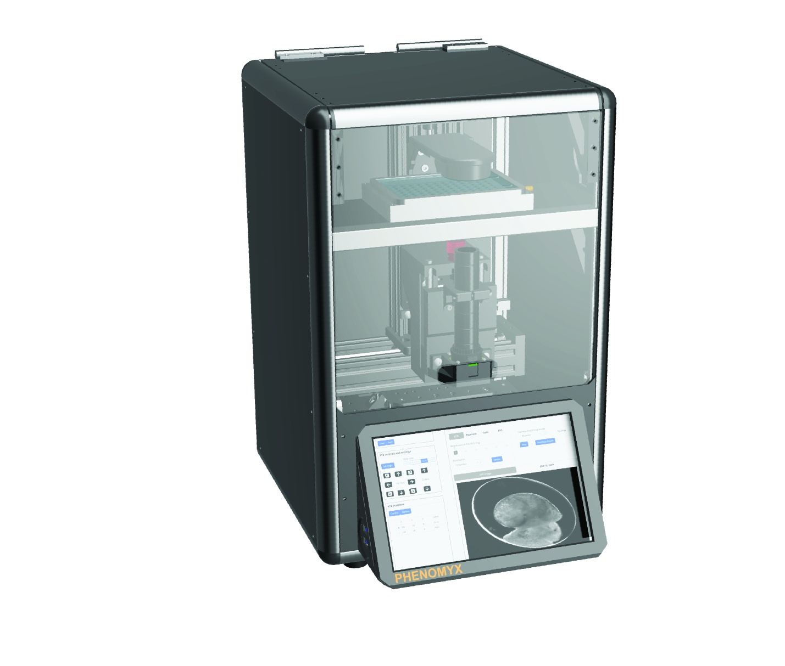

# RoboCam

## Robotic instrument for timelapse imaging in multiwell plate format

RoboCam is a compact, modular laboratory instrument, with robotic motion and built-in compute, it is capable of timelapse imaging of various multiwell plate formats. 

Some of the key specifications of this instruments are as follows:

| Component | Description |
|:---|:---|
| Robotic stage | Automated lead-screw driven XYZ stage with < 1 µm precision and < 10 µm repeatability. The stage is camera-driven rather than sample-driven, reducing vibration transmitted to samples. |
| Processors | Raspberry Pi 5 8Gb RAM computer with built-in fast NVME storage running Debian Linux. |
| Camera sensor | Two camera sensor options: Global shutter CMOS 1.58-megapixel (Sony IMX296LQR-C). Rolling shutter CMOS 12.3-megapixel (Sony IMX477R) |
| Video resolution | Global shutter: 1456x1088 60fps max: Rolling shutter: 1920x1080 50fps max. Higher resolution possible at reduced framerate. Resolution and framerate can be configured using built-in app. |
| Lens | Adjustable high magnification and low magnification lens included. Auxillary, stackable lenses (x2, x3, x4 and x6) provided for high magnification lens to achieve greater magnification. | 
| Lighting | Ring light consisting of 36 individually lit 3mm LEDs. Brightness can be configured and controlled through built-in app. |
| Configuration | Setup via Web App using built-in touchscreen, enabling live stream and config of camera sensor, positioning of XYZ stage and programming of experimental schedule. Experimental data can be captured to built-in disk or to USB attached storage. |
| Sensors | Compact, enclosed aluminium frame with damped door for access and panel cutouts for routing of auxiliary hardware. | 
| Dimensions | 325 mm x 442 mm x 510 mm |
